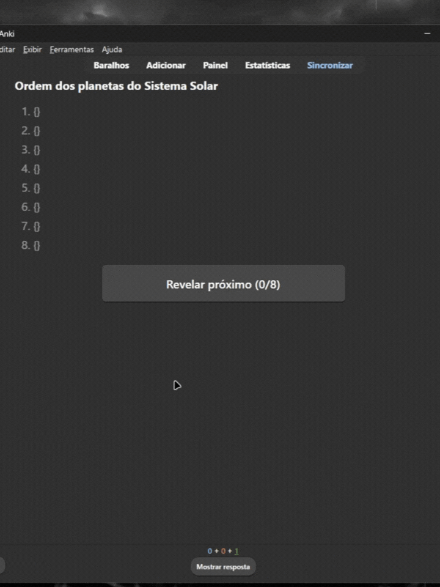

# Progressive Cloze (add-on para Anki)

Tipo de nota para o Anki em que uma lista longa vira **um único cartão**: um botão revela um item por vez, e você confere conforme avança. Ao terminar, use o "Mostrar resposta" do Anki e dê a nota ao cartão. O agendamento não é alterado.

## Por que existe
Para revisar listas (presidentes, obras de um autor, etapas de um processo), o cloze padrão do Anki exige lembrar a lista inteira de uma vez. Este cartão deixa tentar lembrar cada item, revelar o próximo e conferir passo a passo.

## Instalação

1. Anki: Ferramentas > Complementos > Obter complementos, e cole o código **2071826121**.
2. Reinicie o Anki.
3. Ferramentas > **Instalar Progressive Cloze**.

## Como usar
Crie uma nota do tipo `Progressive Cloze`:
- `Pergunta`: o título da lista.
- `Itens`: um item por linha (Enter entre eles).
- `Observações`: opcional.

Exemplo: Pergunta = *Obras de Shakespeare em ordem cronológica*.

## Celular
Sincronize o Anki no computador. O tipo de nota vai junto, sem instalar nada no AnkiDroid ou AnkiMobile.

## Estrutura
- `addon/`: código do add-on (`__init__.py`, `manifest.json`) e os modelos do cartão (`templates/`).
- `manual/`: instalação sem add-on.

## Tecnologias
HTML, CSS e JavaScript (cartão); Python (add-on que instala o tipo de nota).

## Autor
Felipe M.
